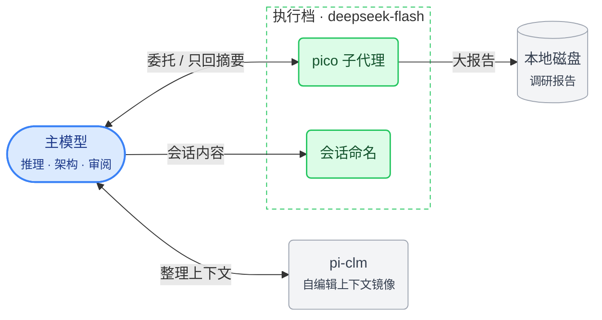

<div align="center">

# pi-playbook

一套 [pi](https://github.com/earendil-works/pi)（`@earendil-works/pi-coding-agent`）的配置参考手册。<br>配置取自本机日常环境，讲清每类配置补什么缺口、每个插件为何选用、每个参数管什么。

[理念与路线](docs/01-理念与路线.md) · [插件总览](#插件总览) · [文档导航](#文档导航) · [套用配置](#套用这份配置)

</div>

<br>

> **贵的模型做决策，便宜的模型做执行；上下文交给模型自己整理，能写盘就写盘。**



主模型按需随新版本更替，机械执行与命名交给廉价档；当前选用的模型与接入方式见 [ref-models.md](docs/ref-models.md)。

## 从哪里开始

- **系统上手**：从 [01 理念与路线](docs/01-理念与路线.md) 顺着主线读，文末逐页衔接。
- **按需挑插件**：浏览下方[插件总览](#插件总览)，点插件名跳转对应小节；每节开头都有速览卡，便于判断是否值得装。
- **直接复用配置**：[`config/`](config/) 收录本机配置的脱敏副本，安装步骤见[套用这份配置](#套用这份配置)，各篇的“我的配置”逐项说明了取舍依据。
- **调优查参数**：插件参数集中在各小节末尾的参数表，pi 本体设置查[参考](#参考)。

## 插件总览

四个阶段按“补哪类缺口”与“对 pi 改动多深”划分，详见 [01 理念与路线](docs/01-理念与路线.md#阶段的划分逻辑)。

### 基础阶段 · 补齐基本能力

| 插件 | 作用 |
|------|------|
| [pi-web-access](docs/02-基础阶段.md#pi-web-access--联网能力) | 补齐联网搜索、网页 / PDF / 视频抓取与带引用的事实查证 |
| [pi-autoname](docs/02-基础阶段.md#pi-autoname--会话命名) | 自动为会话命名，话题转向后在后台更新 |

### 进阶阶段 · 效率与交互

| 插件 | 作用 |
|------|------|
| [pi-fff](docs/03-进阶阶段.md#ff-labspi-fff--搜索增强) | 用 Rust 引擎替换内置 find / grep，按常用度与近期访问排序 |
| [pi-context-view](docs/03-进阶阶段.md#pi-context-view--上下文观察) | 分类展示上下文占用，列出最近一次请求注入的隐藏内容 |
| [pi-cache-graph](docs/03-进阶阶段.md#pi-cache-graph--缓存观测) | 绘制提示缓存命中率曲线，查看逐条消息的 token 明细 |
| [rpiv-ask-user-question](docs/03-进阶阶段.md#juicesharprpiv-ask-user-question--结构化提问) | 需求不明时弹出结构化问卷供点选，减少反复确认与盲猜 |
| [pi-btw](docs/03-进阶阶段.md#narumitwpi-btw--旁路提问) | 在临时旁路线程中带着当前上下文插问，问答默认不入主会话 |
| [ponytail](docs/03-进阶阶段.md#dietrichgebertponytail--精简改动) | 常驻规则约束模型优先复用现成方案，只写完成任务所需的改动 |
| [pi-quote-blocks](docs/03-进阶阶段.md#pi-quote-blocks--引用回复) | 将选中的回复片段转为引用块，发送时展开为 Markdown 引用 |

### 高阶阶段 · 子代理与上下文管理

| 插件 | 作用 |
|------|------|
| [pi-subagents](docs/04-高阶阶段.md#tintinwebpi-subagents--子代理系统) | 将任务派发到独立子代理会话，支持后台、并行与定时运行 |
| [pi-condense](docs/04-高阶阶段.md#pi-condense--上下文剪枝) | 将已用工具输出逐批压成摘要，原文归档到本地索引按需取回 |
| [pi-clm](docs/04-高阶阶段.md#lolipopshockpi-clm--上下文自管理) | 将下一次请求的上下文镜像为文件，由模型用常规工具自行编辑 |

### 界面与观测 · 任意阶段可装

| 插件 | 作用 |
|------|------|
| [pi-claude-code-ui](docs/05-界面与观测.md#pi-claude-code-ui--工具渲染美化) | 将工具调用与 diff 渲染为 Claude Code 风格的结构化视图 |
| [pi-claude-code-tui](docs/05-界面与观测.md#pi-claude-code-tui--启动页头与输入框本地定制) | 本地定制版，提供 Claude Code 风格的启动页头与圆角输入框 |
| [pi-token-speed](docs/05-界面与观测.md#pi-token-speed--速度仪表) | 在状态栏实时显示 TPS 与首 token 延迟，按速度分档着色 |

## 文档导航

### 主线

按顺序阅读，每页文末可翻至下一篇。

| 文档 | 内容 |
|------|------|
| [01 理念与路线](docs/01-理念与路线.md) | 三个缺口、三条理念、阶段划分、整体架构 |
| [02 基础阶段](docs/02-基础阶段.md) | 前置安装与登录；联网能力、会话命名 |
| [03 进阶阶段](docs/03-进阶阶段.md) | 搜索增强、上下文观察、缓存观测、结构化提问、旁路提问、精简改动、引用回复 |
| [04 高阶阶段](docs/04-高阶阶段.md) | 子代理系统、上下文剪枝、上下文自管理与整体架构 |
| [05 界面与观测](docs/05-界面与观测.md) | 工具渲染、启动页头、本地配色主题、速度仪表、快捷键 |
| [06 pico 子代理](docs/06-pico子代理.md) | 自建执行代理的 frontmatter 与 system prompt 设计 |
| [07 全局指令](docs/07-全局指令.md) | 全局 AGENTS.md：云盘排除、搜索纪律、委托策略，以及 talk-normal 与 Karpathy 约束 |

### 参考

pi 本体配置的逐块注释，调优时按需查阅。

| 文档 | 内容 |
|------|------|
| [settings.json](docs/ref-settings.md) | 思考档位、模型清单、技能发现、主题、工具与插件列表 |
| [models.json](docs/ref-models.md) | 自定义供应商、模型覆盖与思考档位映射 |

## 套用这份配置

[`config/`](config/) 对应本机 `~/.pi/agent/` 下的同名文件，可按需拷入使用：

1. **先装主题**：`settings.json` 指定了自定义主题 `dark-classic`，启动前先复制到主题目录（源文件见 [`config/themes/dark-classic.json`](config/themes/dark-classic.json)）：

   ```bash
   mkdir -p ~/.pi/agent/themes
   cp config/themes/dark-classic.json ~/.pi/agent/themes/
   ```

2. **按需拷入配置**：将需要的配置文件复制到 `~/.pi/agent/`，再按自身环境通过 `/login` 补齐凭证与路径设置。
3. **可选本地扩展**：本地定制启动页头不走 npm 商店，安装步骤见 [`plugins/pi-claude-code-tui/INSTALL.md`](plugins/pi-claude-code-tui/INSTALL.md)。

`~/.agents/skills/` 下的外部技能在本机单独管理，本仓库仅收录 `settings.json` 里的技能发现配置；`auth.json`、模型缓存与会话记录等运行数据均留在本机。

<details>
<summary><b>几点约定</b></summary>

- `config/` 是本机配置的脱敏副本，文档里的“我的配置”与对应文件保持一致。
- 内容按本机 pi **1.6.1** 及已安装插件核对。
- 家目录统一写成 `~`；需要凭证的地方用环境变量名占位，按自身环境设置。`settings.json` 的设备标识 `deviceId` 不入库，其余收录配置与本机一致（`pi-claude-code-tui.json` 除外：本机暂未安装该插件，副本留作备用）。
- 各插件小节的商店链接旁标注本机已装版本号；`settings.json` 的 `packages` 保持本机的无版本写法。
- 参数表分“常用参数”与折叠的“其余参数”，未列出的参数取插件默认值。

</details>

<details>
<summary><b>目录结构</b></summary>

```
pi-playbook/
├── README.md                    # 仓库首页
├── AGENTS.md / CLAUDE.md        # 维护规范（给人和 AI 看）
├── scripts/                     # 维护脚本：链接检查、Mermaid 预览
├── docs/                        # 讲解文档，见上方导航
├── plugins/
│   └── pi-claude-code-tui/      # 本地定制插件（完整源码与定制说明）
├── config/                      # 本机配置的脱敏副本（对应 ~/.pi/agent/）
│   ├── settings.json            #   全局设置（见 ref-settings）
│   ├── models.json              #   自定义供应商与模型覆盖（见 ref-models）
│   ├── keybindings.json         #   快捷键绑定（见 05）
│   ├── web-search.json          #   pi-web-access 配置（见 02）
│   ├── pi-autoname.json         #   pi-autoname 配置（见 02）
│   ├── pi-fff.json              #   pi-fff 配置（见 03）
│   ├── pi-btw.json              #   pi-btw 配置（见 03）
│   ├── subagents.json           #   pi-subagents 配置（见 04）
│   ├── pi-clm/settings.json     #   pi-clm 全局默认配置（见 04）
│   ├── pi-claude-code-tui.json  #   pi-claude-code-tui 界面选择状态（见 05）
│   ├── agents/pico.md           #   pico 子代理定义（见 06）
│   ├── themes/dark-classic.json #   dark-classic 自定义主题（见 05）
│   └── AGENTS.md                #   全局指令（见 07）
├── LICENSE
└── .gitignore
```

</details>

## 致谢

全套配置共涉及 15 个插件：其中 14 个来自社区开发者，仓库与商店链接均附在各阶段文档对应小节开头；`pi-claude-code-tui` 为基于上游改造的本地定制版，完整源码收录在 [`plugins/pi-claude-code-tui/`](plugins/pi-claude-code-tui/)。
