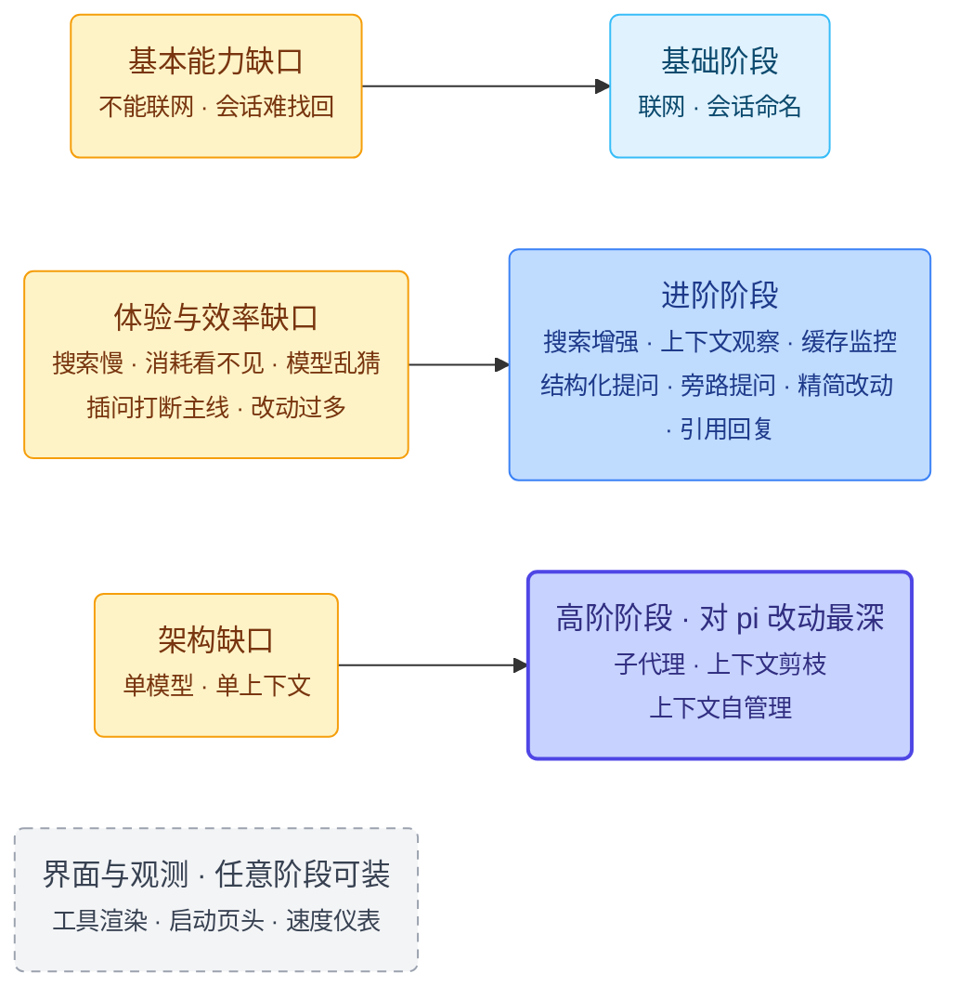
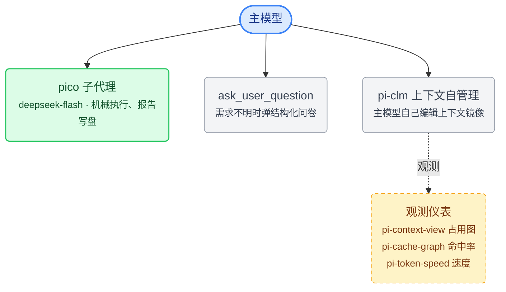

[pi-playbook](../README.md) › [主线](../README.md#文档导航) › **01 理念与路线**

# 理念与路线

这份配置是在日常使用中逐步长出来的，每一项改动都对应一个实际撞上的问题。整个过程守住一条底线：**尽量少动 pi 的原生架构**——能用插件补齐的就用插件，能改配置解决的就不动源码。

本文先讲清楚三件事：pi 开箱后缺什么，按什么思路补，以及这些插件为什么分成四个阶段。

本页内容：[三个缺口](#pi-开箱后的三个缺口) · [三条理念](#三条理念) · [阶段划分](#阶段的划分逻辑) · [整体架构](#整体架构)

## pi 开箱后的三个缺口

pi 本体非常克制，开箱只有终端交互、内置文件工具和模型调用。进入日常开发后，很快会撞上三类缺口。

**基本能力缺口。** 既无法联网查资料，也不会给会话自动起名，聊过几轮之后回头翻记录很费劲。

**体验与效率缺口。** 内置 find/grep 在大仓库里既慢又不按常用度排序；大量低密度的工具输出原样留在窗口里，上下文一路线性膨胀。临近窗口上限时，响应变慢，模型也更容易漏掉前面的细节。

**架构缺口。** pi 默认单模型、单会话，所有活挤在同一个上下文里。任务一复杂，机械执行与关键决策混作一团，既拉高主力模型的 token 成本，又把主上下文搅得杂乱。

## 三条理念

配置里看似零散的插件和参数，背后都指向三条原则。

### 贵的模型做决策，便宜的模型做执行

推理、架构和审阅这类吃判断力的活交给主模型，子代理执行和会话命名这类机械活交给廉价档。按任务性质分层派工，总成本远低于全程顶配。主模型会随新模型发布不断更替，当前选择见 [ref-models.md](ref-models.md)。

这条分工贯穿全套配置：pico 子代理和会话命名统一用 DeepSeek 的 `deepseek-flash`，命名失败时回退到 Codex 的 `gpt-6-luna`。上下文剪枝目前关闭，预设的摘要模型同样是 `deepseek-flash`（thinking 设为 off）。主力模型的额度只花在真正需要判断的环节。

### 让上下文保持高信息密度

长会话里最稀缺的资源是上下文窗口。低信息密度的工具输出不断堆积，会话越来越重，拖到最后只能触发 `/compact` 整体压缩。除 Codex 的服务端压缩外，其余场景下的整体压缩都很容易丢失细节。

这份配置的核心做法是**压低噪声、分级索引**：

- 用 pi-clm 将下一次请求的上下文镜像为文件，由模型自行删减过时的工具输出与无用片段；
- 篇幅较长的调研报告直接写盘，主会话只保留摘要和路径；
- 规模大、可独立拆分的执行任务交给子代理，让原始输出留在子代理会话内。

### 让运行状态看得见

pi 默认几乎不暴露运行指标，输出快慢、窗口被什么占满、缓存命中与否全凭体感。这份配置配齐了三块仪表：TPS 仪表测速度，上下文视图查占用构成，缓存图表盯命中率曲线。调整配置或上下文后效果如何，会话进行中就能拿到直接反馈。

## 阶段的划分逻辑

全部插件按两个维度归类：补的是哪类缺口，以及对 pi 行为的改动有多深。

**基础阶段**补基本能力缺口：加上联网与会话自动命名，pi 便能独立承担日常开发工作。

**进阶阶段**补体验与效率缺口：pi-fff 解决大仓库搜索慢，上下文观察与缓存监控把开销摆上台面，结构化提问让需求模糊时先确认再动手，旁路提问保证临时插问不扰乱主线，ponytail 压住模型过度设计的冲动，引用块方便对长回复逐段回应。

**高阶阶段**补架构缺口，并将上下文管理再推进一步：子代理实现多会话并行与上下文隔离，剪枝与 pi-clm 分别从“外部摘要归档”和“模型自编辑”两条路径控制窗口膨胀。三者对 pi 的改动最深，代价也最直接：子代理需要明确权限边界，剪枝会打断提示缓存，pi-clm 则把留舍权交给模型。本机目前关闭剪枝，上下文管理改用 pi-clm。

**界面与观测**独立于主流程，在任意阶段都能叠加：UI 插件改善终端输出与输入框观感，速度仪表实时展示响应吞吐。

## 整体架构

插件之外，还有两份核心的 pi 本体配置：

- `settings.json` 负责思考档位、模型清单、主题与插件列表等全局设置，逐块拆解见 [ref-settings.md](ref-settings.md)；
- `models.json` 负责自定义供应商与模型覆盖：通过 zenmux 和 akile 聚合网关接入 Claude Fable 5.1、5.2 与 GPT-6 Astra，并用 `modelOverrides` 调整内置 `kimi-coding` 下 `kimi-for-coding` 的显示名、上下文窗口和思考档位，见 [ref-models.md](ref-models.md)。

除此之外，还有两份完全手写的核心资产：`pico` 执行子代理（[06-pico子代理.md](06-pico子代理.md)）和全局 `AGENTS.md`（[07-全局指令.md](07-全局指令.md)）。

---

[返回目录](../README.md#文档导航) · [02 基础阶段](02-基础阶段.md) →
