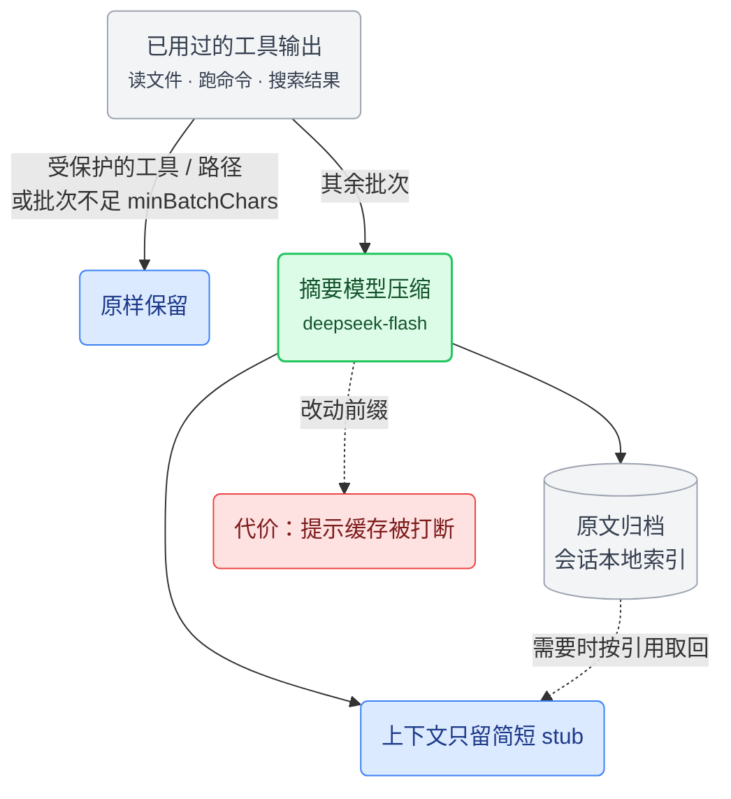
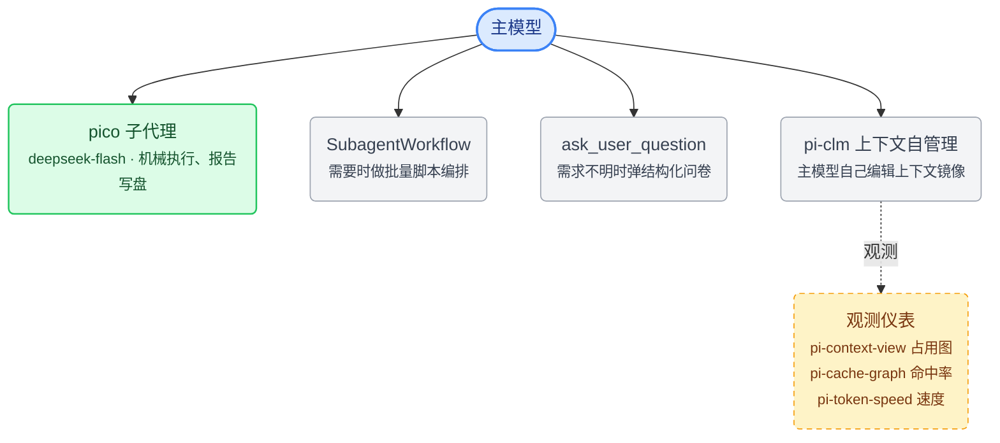

[pi-playbook](../README.md) › [主线](../README.md#文档导航) › **04 高阶阶段**

# 高阶阶段：子代理与上下文管理

本阶段的三个插件对 pi 的改动最深（定位见 [01-理念与路线.md](01-理念与路线.md)）：子代理带来多会话并行与上下文隔离，上下文剪枝将窗口占用从线性膨胀压回基本持平，pi-clm 则把下一次请求的上下文编辑权直接交给模型。三者都会改变 pi 的默认工作方式，代价也最直接：子代理需明确权限边界，剪枝会让历史细节默认不可见并打断提示缓存，pi-clm 则需要信任模型的留舍判断。它们排在最后，是因为要依托前面几个阶段打底——比如上下文改动的真实缓存代价要靠缓存监控来验证。本机目前关闭剪枝，上下文管理改用 pi-clm。

本页内容：[pi-subagents](#tintinwebpi-subagents--子代理系统)（子代理系统）· [pi-condense](#pi-condense--上下文剪枝)（上下文剪枝）· [pi-clm](#lolipopshockpi-clm--上下文自管理)（上下文自管理）· [整体架构](#整体架构)

<br>

## @tintinweb/pi-subagents —— 子代理系统

> **一句话**：主模型通过 `Agent` 工具将任务派发给独立的子代理会话，支持前台、后台、并行与定时运行\
> **收益**：机械执行产生的大段原始输出留在子代理会话内，主上下文保持干净；执行工作可交给廉价模型\
> **代价**：每次委托都有冷启动与重读文件的固定开销；子代理的工具权限等同本机进程，权限边界须自行把关\
> **适合**：常做仓库级调研、批量修改、长耗时测试的人。**不必装**：日常任务都很小，几次工具调用即可完成\
> **改动深度**：将 pi 从单会话扩展为多会话协作；新增 `Agent`、`SubagentWorkflow` 等工具与 `/agents` 面板

商店：[pi.dev/packages/@tintinweb/pi-subagents](https://pi.dev/packages/@tintinweb/pi-subagents) · 仓库：[tintinweb/pi-subagents](https://github.com/tintinweb/pi-subagents) · 本机版本 `0.26.3`

pi 默认单模型、单会话，决策与机械执行挤在同一个上下文里。任务稍大，检索、测试、批量读写等中间输出就会迅速吃掉窗口和 token，连带干扰主模型的判断。

pi-subagents 引入了完整的子代理体系。主模型通过 `Agent` 工具将子任务派发到独立会话，支持：

- 前台阻塞、后台异步、并行派发与定时调度；
- 子代理继续向下委托（嵌套子代理）；
- 通过 git worktree 隔离代码改动；
- 在输入框中用 `@代理名` 直接点名对话；
- 运行中途用 `steer_subagent` 实时纠偏。

遇到运行时才能确定规模的批量多阶段任务，可使用 `SubagentWorkflow`：模型编写确定性的 JavaScript 脚本，用 `agent()`、`parallel()`、`pipeline()` 将多个子代理编排成流水线。

“便宜模型做执行”正是靠这套机制落地：大任务里的机械执行交给 flash 档子代理，主模型专注决策与收口。独立会话隔开了上下文，worktree 隔开了代码改动；但工具执行权限仍等同于本机进程的系统权限，这一点不能忽视。

0.22.0 要求 Pi 1.1.0 或更新版本。

配置分为两层：

- **持久设置**：全局 `~/.pi/agent/subagents.json`，项目目录 `.pi/subagents.json` 可按项覆盖。
- **自定义代理**：每个代理对应一个 Markdown 文件，YAML frontmatter 定义属性，正文即 system prompt。按优先级从高到低依次查找 `.pi/agents/<name>.md`（项目级）、`.agents/agents/<name>.md`（项目共享目录）和 `~/.pi/agent/agents/<name>.md`（全局），同名时项目级覆盖全局。

**我的配置**（[`config/subagents.json`](../config/subagents.json)）：

```json
{
  "maxConcurrent": 10,
  "maxConcurrentForeground": 0,
  "defaultMaxTurns": 0,
  "graceTurns": 5,
  "defaultJoinMode": "smart",
  "backgroundByDefault": true,
  "schedulingEnabled": true,
  "scopeModels": false,
  "strictAgentFiles": false,
  "disableDefaultAgents": true,
  "toolDescriptionMode": "full",
  "fleetView": true,
  "agentMentions": "model",
  "rememberAgents": true,
  "widgetMode": "background",
  "outputTranscript": true,
  "worktreeIsolation": true,
  "workflowsEnabled": false,
  "maxSubagentDepth": 2,
  "reportUsage": false,
  "showCost": false,
  "showModel": false,
  "viewerMarkdown": "assistant"
}
```

0.25.0 之前，`/agents` → Settings 保存时会将所有内置默认值一并落盘，因此文件键数较多。实际偏离默认值的只有 `disableDefaultAgents` 与 `workflowsEnabled` 两项：

- `maxConcurrent: 10`、`maxConcurrentForeground: 0`：后台并发上限 10 个，前台不限
- `maxSubagentDepth: 2`：允许子代理再向下委托一层
- `backgroundByDefault: true`：未指定运行方式时默认放后台
- `disableDefaultAgents: true`：隐藏内置的 general-purpose、Explore、Plan，只保留自定义代理
- `workflowsEnabled: false`：关闭脚本工作流，不注册 `SubagentWorkflow` 工具
- `fallbackSubagent` 未设置：沿用默认的 `general-purpose`，在找不到指定代理类型时兜底

自定义代理只写了 `pico` 一个（[`config/agents/pico.md`](../config/agents/pico.md)），设计细节见 [06-pico子代理.md](06-pico子代理.md)：

- `model: deepseek/deepseek-flash`、`thinking: max`：固定使用 DeepSeek 执行档模型
- `prompt_mode: replace`：正文即完整 system prompt，不继承父级 AGENTS.md
- `allowed_subagents` 未设置：关闭嵌套委托
- `tools`：覆盖了子代理插件识别的全部七个内置工具，因此 `Agent` 工具描述中显示为 `*`；扩展工具另行按名单加载

### SubagentWorkflow —— 脚本化编排

少量、事先就能敲定的独立任务直接用 `Agent`；批量、多阶段任务则交给 `SubagentWorkflow`，以 JavaScript 脚本编排。由于它可能一次派出大量子代理，按使用约定，只在用户明确要求使用工作流或点名已保存的工作流时才会运行。

**写法。** 脚本开头须包含纯字面量的 `export const meta = { name, description }`。核心原语有三个：

- `agent()`：派发单个子代理；
- `pipeline()`：让每一项独立地逐阶段推进；
- `parallel()`：等待整组全部完成后再继续往下走。

能流水推进的优先用 `pipeline()`，确需跨项汇总时再用 `parallel()` 做同步屏障。`schema` 用来校验子代理返回的对象结构，`gate` 则通过命令退出码验收结果。

**运行限制。** 脚本在 worker thread 的 `node:vm` 中执行，禁止读取当前时间、生成随机数或动态执行代码；需要时间戳应通过 `args` 传入。并发上限为 `max(1, min(16, cpus - 2))`，单次运行最多 1000 个代理，`parallel()` / `pipeline()` 单次最多 4096 项。工作流的并发池与主会话的 `maxConcurrent` 相互独立。这些约束旨在保证重放结果的确定性，安全隔离仍依赖运行环境本身。

**观察与控制。** 调用后立即返回 task id，工作流在后台推进，结束后走常规后台通知。`/agents → Workflows` 可打开两层检查面板（阶段 → 代理 → prompt / activity / outcome），快捷键包括 `x` 停止、`p` 暂停、`s` 跳过（该次 `agent()` 返回 `null`）、`r` 重试、`c` 打开该子代理对话。

**脚本复用。** 每次执行的脚本都会留存于会话目录，修改后可用 `scriptPath` 重跑。值得沉淀的脚本放进 `.pi/workflows/`、`.agents/workflows/` 或代理目录的 `workflows/`，后续直接按 `name` 调用。`resumeFromRunId` 可重放同一会话中某次已结束运行的未改动前缀（仅限同会话有效）；启动时也支持用 `--subagents-workflow-file=<path>` 直接运行脚本。

开关 `workflowsEnabled` 默认开启；未显式设置时处于自动让位模式，若检测到其他扩展已注册 `Workflow` / `SubagentWorkflow` 工具，则主动退出。

| 参数 | 说明 |
|------|------|
| `script` | 脚本源码 |
| `scriptPath` | 脚本文件路径，优先级高于 `script` 与 `name` |
| `name` | 已保存的脚本名，在三个 `workflows/` 目录中查找 `<name>.js` |
| `args` | 原样注入脚本全局的 `args` 参数 |
| `resumeFromRunId` | 重放同一会话内某次已结束运行的未变前缀 |

`title` / `description` 两个参数接受但忽略，工作流名称一律以 `meta` 为准。

### 参数

**常用参数 · subagents.json**

| 参数 | 默认 | 说明 |
|------|------|------|
| `maxConcurrent` | `10` | 后台代理最大并发数，超出部分排队等待。遇到 API 限流或本机负载吃紧时调低。 |
| `maxConcurrentForeground` | `0` | 前台代理的独立并发上限，`0` 为不限，不占用后台名额。本地模型不宜并发时可设为 `1`。 |
| `backgroundByDefault` | `true` | 调用方未指定运行方式时的默认行为，嵌套派发始终默认前台。<br>· `true`：立即返回任务 ID<br>· `false`：阻塞等待结果返回 |
| `workflowsEnabled` | `true` | 工作流工具开关，通常不必显式设置。<br>· `false`：禁用<br>· `true`：强制启用<br>· 不写：自动让位，已有其他扩展提供同类工具时退出 |
| `maxSubagentDepth` | `2` | 嵌套深度上限，主会话计 0，一级子代理计 1。<br>· `2`：允许子代理再委托一层<br>· `0` / `1`：全局禁止嵌套 |
| `fallbackSubagent` | `general-purpose` | 指定代理类型不存在、已禁用或存在歧义时的兜底代理。设为 `none` 则直接报错，防止任务悄然落到权限更高的代理上。 |

**常用参数 · 代理 frontmatter**

| 参数 | 默认 | 说明 |
|------|------|------|
| `model` | 继承父模型 | 代理所用模型。写 `provider/modelId` 优先走该渠道，也支持 haiku、sonnet 这类模糊名；若该渠道无此模型，仍可能回退至其他可用渠道。 |
| `tools` | 不设 | 可用的内置工具列表；`ext:` 选择器仅筛选扩展工具，不负责加载扩展。<br>· `*` / `all`：全部内置工具<br>· `none`：关闭全部内置工具<br>· `ext:扩展`：选取整组扩展工具<br>· `ext:扩展/工具`：选取单个扩展工具 |
| `allowed_subagents` | `none` | 是否允许继续向下委托。子代理权限彼此独立，名单宜只列必需类型。内置的 `general-purpose` 自 0.25.0 起默认允许再委托。<br>· `none`：禁止<br>· `all`：允许任意已启用代理<br>· 列表：仅允许指定类型 |

<details>
<summary><b>其余参数（43 项）</b></summary>

**subagents.json**

| 参数 | 默认 | 说明 |
|------|------|------|
| `maxConcurrentNested` | `10` | 嵌套子代理并发上限，`0` 为不限。超出时不排队，嵌套 `Agent` 调用直接报错并交回父代理自行处理；顶层代理不计入。 |
| `graceTurns` | `5` | 触及轮数上限后额外预留的收尾轮数，用于整理结论。调小止损更快，调大收尾更从容。 |
| `defaultMaxTurns` | 不限 | 代理未设 `max_turns` 时的默认轮数上限，防止任务无限空转；触及后仍享有宽限轮。 |
| `headlessWaitMinutes` | `0` | 无界面模式（`pi -p`、JSON 模式）在主轮次结束后等待后台代理和工作流完成的时长上限（分钟）；`0` 为不限，超限后中止后台任务。 |
| `schedulingEnabled` | `true` | 开启后支持通过 `schedule` 延迟或周期派发。用不到定时任务时可关掉，避免模型误排计划。 |
| `agentMentions` | `model` | 用 `@` 触发新代理的方式；在 `model` 和 `direct` 下，已存在的代理都会直接收到消息。<br>· `model`：交给主模型组织提示词后派发<br>· `direct`：直接以输入文本启动<br>· `off`：禁用提及 |
| `rememberAgents` | `true` | 持久化子代理会话，后续可通过 `/resume` 或再次 `@` 续接。关闭后，内存记录一过期便无法续接。 |
| `cacheRetention` | `inherit` | 子代理请求的提示缓存保留策略，不影响主会话；适合让短命子代理避开主会话的 `long` 档。<br>· `inherit`：沿用 pi 默认与 `PI_CACHE_RETENTION`<br>· `none`：不缓存<br>· `short`：短保留（Anthropic 为 5 分钟）<br>· `long`：长保留（Anthropic 为 1 小时） |
| `reportUsage` | `false` | 将子代理的 token 与费用计入主会话统计。关注任务总成本时开启，只看主模型开销时关闭。 |
| `showCost` | `false` | 在子代理界面展示估算费用，便于横向比较模型成本；不影响主会话的费用统计。 |
| `showModel` | `false` | 在运行挂件与 FleetView 的代理行显示模型及思考档位。混用多模型时开启；窄终端或单一模型时可关闭。 |
| `viewerMarkdown` | `assistant` | 对话查看器的 Markdown 渲染范围；排查日志或 diff 原文时选 `off`。<br>· `off`：显示原始文本<br>· `assistant`：仅渲染助手消息<br>· `all`：查看器自身打印的结果块也一并渲染<br>工具调用及其结果由各自渲染器绘制，不受此项影响。 |
| `outputTranscript` | `true` | 将完整对话另存为 `.output` 转录文件以便审计。关闭仅停写转录，会话持久化与记忆照常落盘。 |
| `disableDefaultAgents` | `false` | 隐藏内置的 general-purpose、Explore、Plan，仅显示自定义代理。若要彻底杜绝兜底派发，须同时将 `fallbackSubagent` 设为 `none`。 |
| `scopeModels` | `false` | 按 `enabledModels` 校验调用方传入的模型。代理文件里固定或继承的模型越界时只发警告，因此不能视作硬性费用隔离。 |
| `strictAgentFiles` | `false` | 开启后，代理文件读取或解析失败会直接阻断扩展启动；关闭时只警告并跳过。会话中途重载始终只警告。 |
| `worktreeIsolation` | `true` | 允许创建 git worktree 隔离代码改动。关闭可省去复制耗时与磁盘开销，但要求隔离的任务会退回当前目录执行。 |
| `defaultJoinMode` | `smart` | 多个后台代理完成时的通知策略；想减少主会话唤醒次数可选 `group`。<br>· `smart`：不等其他代理，各自结果在主会话下一个边界送达；`async` 为其旧名<br>· `group`：同轮派出的后台代理全部完成后合并通知，先完成的会等待最慢一个 |
| `toolDescriptionMode` | `full` | 暴露给模型的派发说明版本，修改后新会话生效。<br>· `full`：完整说明<br>· `compact`：精简说明，节省上下文<br>· `custom`：读取自定义说明文件 |
| `workflowToolExposure` | `inline` | `SubagentWorkflow` 脚本参考的提供方式，修改后新会话生效。<br>· `inline`：完整写入工具说明<br>· `skill`：工具说明仅指向内置 `workflow-authoring` 技能，可省约 4k token，但依赖模型主动读取<br>· `deferred`：不放进初始工具表，由 pi 的 `tool_search` 按需加载（须启用 `tool_search`） |
| `packageAgents` / `packageWorkflows` | `true` | 是否加载已装 pi 包附带的子代理与工作流脚本。包内代理优先级低于手写的同名代理。<br>· `true`：全部包都加载<br>· `false`：全部不加载<br>· 列表：仅加载指定包 |
| `widgetMode` | `background` | 上方运行挂件展示的任务范围。<br>· `all`：全部任务<br>· `background`：仅显示后台任务，避免与前台输出重复<br>· `off`：隐藏挂件，仍可在 `/agents` 面板查看 |

`scopeModels` 只匹配精确的 `provider/modelId`，不支持 glob 或思考后缀；清单为空时跳过校验。`toolDescriptionMode: custom` 依次查找项目 `.pi/agent-tool-description.md` 与全局 `~/.pi/agent/agent-tool-description.md`（项目优先），缺失或为空时退回 `full`。

**代理 frontmatter**（全字段可选）

| 参数 | 默认 | 说明 |
|------|------|------|
| `name` | 文件名 | 派发与 `@` 点名使用的类型名，不能含 `:`。需要稳定的调用标识时显式指定，不受界面显示名影响。 |
| `display_name` | 类型名 | 挂件与列表中显示的标签，可用中文角色名，不影响 `name` 的派发身份。 |
| `description` | 不设 | 供模型挑选代理的说明。写明擅长边界与不适用场景，比笼统称“专家”更有用。 |
| `color` | 不设 | 代理徽章底色，支持 `blue` 等预设名或带引号的 `"#8B5CF6"`。仅作视觉区分，不影响行为。 |
| `memory` | 不开启 | 持久记忆的作用域；不写则关闭，代理无写工具时记忆为只读。<br>· `project`：存于项目内，团队共享<br>· `local`：存于项目内，仅个人可见<br>· `user`：跨项目复用 |
| `thinking` | 继承 | 思考档位。档位越高通常越耗时耗 token；机械任务宜先试 `off` / `low`，复杂推理再升档。模型不支持的档位会自动向下收窄。 |
| `max_turns` | 不设 | 该代理的轮数上限，`0` 为不限。短任务设小些可防绕圈；到上限先进入收尾，宽限轮耗尽后才中止。 |
| `extensions` | `true` | 要加载的扩展；轻量代理可关闭，依赖联网等扩展能力时按需列出。<br>· `true`：加载默认扩展<br>· `false`：不加载任何扩展<br>· 列表：仅加载指定扩展 |
| `exclude_extensions` | 不设 | 从已选扩展中进一步剔除指定项，排除规则优先。适合默认全开、只需去掉个别通知或界面扩展的场景。 |
| `skills` | `true` | 技能继承方式。<br>· `true`：继承父代理技能<br>· `false`：不继承<br>· 列表：只将指定技能全文预载进提示，其余不再继承 |
| `disallowed_tools` | 不设 | 最终禁用的工具名，扩展注册的同名工具也会被禁。常用于从较宽的工具集里剔除写入类能力。 |
| `isolated` | `false` | 强制只保留内置工具，不加载扩展和技能。适合输入已完备的封闭任务；注意它并非文件系统沙箱。 |
| `isolation` | `off` | 代码改动落点；注意 worktree 副本看不到未提交的本地修改。<br>· `worktree`：在独立仓库副本中改代码，提交至独立分支<br>· `off`：始终在当前工作目录运行 |
| `prompt_mode` | `replace` | 正文生效方式；专职代理选 `replace`，需要共享全局规范选 `append`。<br>· `replace`：将正文作为完整 system prompt，不继承父级 AGENTS.md<br>· `append`：在父级提示后追加角色指令 |
| `inherit_context` | `false` | 开启后复制父会话历史，省去重新交代背景，但输入成本随之上升。任务独立且说明完整时保持 `false`。 |
| `run_in_background` | 跟随调用参数 | 固定该代理的运行模式。<br>· `true`：始终后台运行<br>· `false`：始终前台等待<br>· 不写：由调用参数或 `backgroundByDefault` 决定 |
| `persist_session` | 跟随 `rememberAgents` | 覆盖 `rememberAgents`，单独控制是否保存可续接会话。临时任务可关闭；`.output` 转录另由独立开关控制。 |
| `output_transcript` | 跟随 `outputTranscript` | 覆盖 `outputTranscript`，单独决定是否写完整转录。关闭不影响会话持久化，敏感任务须同时核对两项。 |
| `cache_retention` | 跟随 `cacheRetention` | 覆盖 `cacheRetention`，单独指定该代理的提示缓存保留策略（`inherit`、`none`、`short`、`long`）。 |
| `session_dir` | pi 默认位置 | 持久化会话的存放目录，相对路径从代理工作目录起算。一般留空，需要独立归档时再指定。 |
| `enabled` | `true` | 设为 `false` 隐藏该代理，便于在项目级禁用某个全局或内置代理，无需删文件。 |

frontmatter 中已写明的模型、思考档位、轮数、上下文继承与运行方式均优先于调用参数。`tools: none` 只关闭内置工具，不会连带关闭扩展工具；只有出现任一 `ext:` 选择器时，扩展工具才按显式名单筛选。`exclude_extensions` 与 worktree 都不是安全沙箱，不能用来隔离不可信代码。

</details>

<br>

## pi-condense —— 上下文剪枝

> **一句话**：把已用过的工具输出逐批压成摘要，原文归档到本地索引，需要时按引用取回\
> **收益**：将上下文占用从线性增长压回基本持平，让长会话撑得下去，少走整体 compact 这条信息损失最大的老路\
> **代价**：历史细节默认不可见，需由模型主动取回；每批摘要多一次模型调用；改写前缀会打断提示缓存\
> **适合**：常跑长会话、窗口频频逼近上限的人。**不必装**：会话普遍较短，或更看重缓存命中率\
> **改动深度**：直接改写发给模型的上下文，是全套配置中改动最深的插件；安装后默认关闭，须手动开启

商店：[pi.dev/packages/pi-condense](https://pi.dev/packages/pi-condense) · 仓库：[jjuraszek/pi-condense](https://github.com/jjuraszek/pi-condense) · 本机版本 `2.18.2`

上下文是长会话里最金贵的资源。pi 默认让历史工具输出一直留在窗口中：读过的大文件、跑过的命令、搜出的长列表越积越多，会话越聊越贵、响应越来越慢，最终被迫触发 compact，把整段对话压成一团摘要——这是信息损失最重的一种收场方式。

pi-condense 改走逐批归档路线。每次 flush 时，已经用过的工具输出交由摘要模型压成简短 stub，原文归档进会话本地索引；模型需要核对细节时，再通过 `context_tree_query` 按引用取回。历史原文平时不占窗口、用时仍能拿回，上下文占用得以从线性增长压回基本持平，长会话才撑得下去。



代价同样清晰，共有三项：

- 历史细节默认不可见，依赖模型主动按引用取回；
- 每批摘要都需要一次额外的模型调用；
- 剪枝改写前缀，必然打断提示缓存。

三项最终都会反映在成本上，其中缓存打断的影响最大。因此，剪枝何时触发、摘要模型怎么选，是使用这个插件时最该拿捏的参数。

2.18.0 要求 pi 1.5.1 或更新版本。

插件默认关闭，须设 `enabled: true`（或在会话内执行 `/pruner on`）才会工作。配置写在 `settings.json` 的 `contextPrune` 段。会话中通过 `/pruner` 系列命令控制：

- `/pruner on`、`/pruner off`：开关剪枝
- `/pruner status`：查看开关状态、摘要模型、触发方式、分批方式与统计
- `/pruner stats`：查看摘要模型累计消耗的 token 与费用
- `/pruner tree`：在折叠树中浏览已剪枝的工具调用
- `/pruner now`：立即处理待剪枝的工具调用
- `/pruner compact`：对所有已结束的任务链补做链压缩，不受 `rollingWindow` 限制
- `/pruner settings`：打开交互式设置面板
- `/pruner <子命令> [值]`：查看或修改单项配置，子命令包括 `model`、`thinking`、`prune-on`、`batching`、`min-batch-chars`、`recovery-grace`、`dedup`、`protected-tools`、`protected-paths`；省略值时显示当前设置或打开交互选择
- `/pruner help`：显示帮助

**我的配置**（`settings.json` 的 `contextPrune` 段，完整文件见 [`config/settings.json`](../config/settings.json)）：

```json
{
  "enabled": false,
  "showPruneStatusLine": false,
  "summarizerModel": "deepseek/deepseek-flash",
  "summarizerThinking": "off",
  "pruneOn": "agent-message",
  "batchingMode": "agent-message",
  "quietOversizedSkips": true,
  "minBatchChars": 8000,
  "recoveryGraceTurns": 3,
  "summarizerIdleTimeoutMs": 45000,
  "summarizerMaxTimeoutMs": 100000,
  "protectedTools": [
    "ask_user_question",
    "Agent",
    "get_subagent_result",
    "web_search",
    "source_check",
    "get_search_content"
  ],
  "protectedPaths": ["**/skills/**/*.md"],
  "chainCompression": {
    "enabled": false,
    "rollingWindow": 3,
    "stripFinalAssistantThinking": true,
    "fuseRangeSummary": true
  },
  "purgeErrors": {
    "enabled": true,
    "cooldownTurns": 2,
    "minArgChars": 500
  },
  "dedupByContentHash": true,
  "autoBudgetThreshold": null,
  "spillThreshold": 16384,
  "spillPreviewBytes": 2048,
  "budgetTurnDelta": null,
  "frontierGapThresholdTokens": null,
  "maxImagesPerRequest": null
}
```

> [!WARNING]
> **调整剪枝参数时，务必同时盯住缓存命中率和摘要开销。** 剪枝会改写会话前缀，直接影响后续请求的缓存复用。摘要模型、批量门槛、链压缩开关与 spill 阈值共同决定了成本和延迟，调完后用 `/pruner status` 和 `/cache graph` 对照实测效果。

几个关键取舍：

- `enabled: false`：本机目前关闭剪枝，上下文管理改用 pi-clm（见[下一节](#lolipopshockpi-clm--上下文自管理)）。其余各项为此前开启剪枝时的取舍，配置原样留存。
- `summarizerModel: deepseek/deepseek-flash`、`summarizerThinking: off`：与 pico、会话命名共用同一档执行模型，区别在于思考档位——pico 开 `max`，摘要则关闭推理档位，优先压低延迟和费用。
- `minBatchChars: 8000`：比默认门槛（2000）高出四倍，避免为小批次付费生成与原文差不多长的摘要。不足 8000 字符的批次直接跳过，不会攒到下次合并。
- `chainCompression.enabled: false`：链级压缩会改写滚动窗口之外的历史链，破坏前缀缓存原本稳定的部分。单层剪枝已经够用，关掉链压缩换取更稳的缓存命中率，差异可在 pi-cache-graph 里直接验证。
- `protectedTools`：保护六个关键工具——`ask_user_question`（提问）、`Agent` 与 `get_subagent_result`（子代理）、`web_search` / `source_check` / `get_search_content`（联网）。它们的输出往往是决策依据，剪掉会让模型丢失判断基础。2.10.3 起有一条例外：带字符串 `path` 参数的受保护调用，同一路径只保留最新一次读取，旧读取替换为 `[Superseded: …]` stub；2.13.0 起进一步收紧为只有新读取覆盖旧读取行范围时才替换，互不相交的分块照常保留。这六个工具基本不带 `path` 参数，这条规则主要落在 `protectedPaths` 上。
- `protectedPaths: ["**/skills/**/*.md"]`：只显式保留技能文件一条。2.18.2 起插件默认值为 `["**/skills/**/*.md", "**/gauntlet-overrides.md", "**/.pi/gauntlet.md"]`，显式配置会整体替换默认值，因此 gauntlet 相关文件不在保护之列。
- `spillThreshold: 16384`：低于默认的 65536，让超大输出更早转存至旁路文件，上下文中只留 2KB 预览。
- `summarizerMaxTimeoutMs: 100000`：低于默认的 180000。廉价档模型做摘要本身够快，收紧超时能避免断断续续的慢响应拖慢整轮剪枝。

### 参数

**常用参数**

| 参数 | 默认 | 说明 |
|------|------|------|
| `enabled` | `false` | 工具输出剪枝总开关，仅处理开启后捕获的批次。关闭后不再剪枝，但图片上限保护仍生效。 |
| `summarizerModel` | `default` | `default` 沿用当前模型；填 `provider/model-id` 可另选便宜、快速的摘要模型，压低每批剪枝的费用与等待。 |
| `minBatchChars` | `2000` | 批次原文不足 N 字符时直接跳过，不留到下次凑数。调高可省去小批次的摘要费用，设为 `0` 则所有批次均尝试摘要。 |
| `pruneOn` | `agent-message` | 剪枝触发时机；想完全自己掌控缓存何时失效时选 `on-demand`。<br>· `agent-message`：助手给出最终纯文本回复后自动剪枝<br>· `on-demand`：仅在执行 `/pruner now` 时剪枝 |
| `protectedTools` | `[]` | 按精确工具名保留原文，适合计划、句柄等需反复查阅的输出。带 `path` 参数的调用，同一路径只保留最新一次。 |
| `spillThreshold` | `65536` | 单条输出达到 N 字符后直接转存旁路文件，跳过摘要。调低更省窗口，但模型会更频繁地回头读文件。 |

<details>
<summary><b>其余参数（22 项）</b></summary>

**主开关与触发**

| 参数 | 默认 | 说明 |
|------|------|------|
| `autoBudgetThreshold` | `null` | 上下文占用达到指定比例时强制剪枝（如 `0.8` 即 80%），触发点最高按 30 万 token 计算。`null` 为关闭；长耗时单轮任务可开启。 |
| `budgetTurnDelta` | `null` | 单轮增幅超过窗口指定比例时强制剪枝，窗口上限同样按 30 万 token 计（如 `0.1` 在大窗口上对应增长 3 万 token）。`null` 为关闭。 |
| `frontierGapThresholdTokens` | `null` | 未剪枝尾部达到 N token 时于轮末触发剪枝。适合大窗口长任务，可从 `80000` 试起；调低剪得更勤，`null` 为关闭。 |
| `showPruneStatusLine` | `true` | 在底栏显示剪枝状态。调参期打开便于观察，想腾出底栏空间时关闭；统计随时可用 `/pruner status` 查看。 |

`pruneOn` 管何时触发，`batchingMode` 管如何合批，互不干扰。`autoBudgetThreshold`、`budgetTurnDelta`、`frontierGapThresholdTokens` 属于额外触发器，即便选用 `on-demand` 仍会生效；若要彻底手动剪枝，须将三项全部设为 `null`。

**摘要模型**

| 参数 | 默认 | 说明 |
|------|------|------|
| `summarizerThinking` | `default` | 摘要模型的思考档位，一般先试 `off`。<br>· `default`：沿用提供方默认<br>· `off`：不请求推理档位<br>· 其余档位：逐级提高思考预算 |
| `summarizerIdleTimeoutMs` | `45000` | 连续 N 毫秒收不到流事件即中止，同时限制首 token 等待时长。慢模型可调高，`0` 表示禁用空闲超时。 |
| `summarizerMaxTimeoutMs` | `180000` | 单次摘要的总时长上限（毫秒），防止流断断续续却久拖不决。`0` 为禁用；应设得高于空闲超时。 |

**批量与质量门**

| 参数 | 默认 | 说明 |
|------|------|------|
| `batchingMode` | `turn` | 摘要分批方式。<br>· `turn`：每个助手轮次单独摘要<br>· `agent-message`：将用户提问到最终回复之间的工具输出合并成一批，调用次数更少但单批更大 |
| `quietOversizedSkips` | `false` | 静默“批次过小”和“摘要长于原文”两类跳过提示。仅减少界面噪音，不改变剪枝行为。 |
| `dedupByContentHash` | `true` | 与已归档内容完全一致的输出直接改为引用，不再重调摘要模型。调试重复读取、需要并排保留原文时关闭。 |
| `recoveryGraceTurns` | `3` | 取回的原文保留几个用户轮次后再变回引用。调高减少反复取回，调低更省窗口，`0` 则立即恢复为引用。 |

**保护、转存与图片**

| 参数 | 默认 | 说明 |
|------|------|------|
| `protectedPaths` | `["**/skills/**/*.md", "**/gauntlet-overrides.md", "**/.pi/gauntlet.md"]` | 按调用参数 `path` 做 glob 匹配，保留规则文件等关键内容。显式列表会整体替换默认值，`[]` 取消路径保护。 |
| `spillPreviewBytes` | `2048` | 转存后留在上下文里的开头预览长度，单位为字节而非字符。调大便于判断原文内容，调小更省空间。 |
| `maxImagesPerRequest` | `null` | 每次请求最多保留最近 N 张图，更早的图片替换为文字占位。遇到提供方报图片数超限时调低；`null` 沿用内置上限（见下文）。 |

图片上限在 `enabled: false` 时依然生效：`null` 对 Anthropic Messages 采用 100 张上限，其他 API 不限。清理按 N 的一半分档执行，可能一次移除多张旧图，避免每轮都改动缓存前缀。

**链压缩**（写在 `chainCompression` 对象里）

| 参数 | 默认 | 说明 |
|------|------|------|
| `enabled` | `true` | 对滚动窗口之外的已结束任务链（从用户提问到最终回复）再做一层压缩。更省上下文，但会改写更多前缀；优先保缓存时可关闭。 |
| `rollingWindow` | `3` | 最近 N 条已结束的任务链不做链压缩。调大保留更多近期上下文，调小压得更紧；仅在链压缩开启时生效。 |
| `idleCleanupMinutes` | `180` | 空闲超过 N 分钟后的第一条人类消息发出前，直接压缩已结束的任务链并替换待处理的重复受保护读取，不融合摘要也不额外调用模型；须在 `agent-message` 模式下同时开启剪枝和链压缩。若模型声明的缓存有效期更长，则以更长者为准；助手回复和缓存预热会重置计时。 |
| `stripFinalAssistantThinking` | `true` | 链压缩时去掉最终回复附带的思考块，仅保留正文回答。需回查历史推理过程时关闭。 |
| `fuseRangeSummary` | `true` | 将同一任务链的多批摘要融合成一条，会多一次摘要模型调用；关闭则直接拼接已有摘要，更省费但内容可能略有重复。 |

**错误清理**（写在 `purgeErrors` 对象里）

| 参数 | 默认 | 说明 |
|------|------|------|
| `enabled` | `true` | 把失败工具调用的大段输入参数换成短标记，防止失败重试越堆越长。已摘要调用的长字符串参数也会一并收缩，可用 `context_tree_query` 取回。不删除错误结果本身；排错需要保留原参数时关闭。 |
| `cooldownTurns` | `2` | 失败后延迟 N 个轮次再清理参数，仅针对失败调用生效。调大给模型留出纠错窗口，调小回收更快。 |
| `minArgChars` | `500` | 只清理超过 N 字符的调用参数，失败调用与已摘要调用共用此门槛。调高保留中等长度输入，调低清理更积极。 |

</details>

<br>

## @lolipopshock/pi-clm —— 上下文自管理

> **一句话**：把下一次请求的上下文镜像为本地文件，让模型用常规文件工具直接改写，改完的版本即下一次请求的上下文\
> **收益**：留什么、删什么完全由模型按当前任务判断；pi 原始会话历史不受改写；`/clm` 面板可追踪上下文体积曲线与每次修订差异\
> **代价**：模型可能误删后续仍需的信息；可编辑上下文也会引入提示注入攻击面；溢出保护开启期间，pi 按阈值触发的自动压缩默认被取消\
> **适合**：常跑长会话、愿意把上下文整理权交给模型的人。**不必装**：会话普遍较短，用不到上下文管理\
> **改动深度**：改写发给模型的上下文，并向系统提示注入编辑协议；新增 `/clm` 系列命令与 `live_context_annotate`、`live_context_recall` 两个工具，不包装内置工具

商店：[pi.dev/packages/@lolipopshock/pi-clm](https://pi.dev/packages/@lolipopshock/pi-clm) · 仓库：[lolipopshock/pi-clm](https://github.com/lolipopshock/pi-clm) · 本机版本：本地定制（基于上游 v1.1.0）

pi-clm 让模型自己管理上下文，思路源自论文 [Context Language Models](https://arxiv.org/abs/2609.37725)。核心闭环分三步：

- 每次请求前，插件将模型即将看到的对话写进一份私有镜像文件；
- 模型在这一轮中用 bash、edit、write 等普通工具直接修改该文件——缩短过时的工具输出、删除或重排消息块、插入笔记块，甚至整体改写为一段精炼纯文本；
- 轮次结束时插件校验文件：未改动的消息沿用原对象，成对的工具调用按需修复，最终保存为当前分支的一条修订，供下一次请求生效。

pi 原生会话文件始终只追加、不改写。上下文要不要缩、缩到什么程度都由模型自己拿主意，插件只负责兜住请求合法性，并在窗口占用触及预算的 50%、75%、90% 时向模型上下文注入一条 `[CLM BUDGET]` 提醒。

另有两件事不经模型，由插件自动处理：

- **溢出保护**：当估算请求超出预算时，自动把最后一次编辑之后最旧的工具结果压成一行说明，附上存有全文的文件路径。预算默认取模型上下文窗口，实际触发线还会扣掉留给生成的余量；
- **估算校准**：先按 4 字符 ≈ 1 token 估算体积，再用供应商返回的实际计数持续校准。

由于 pi 自带的自动压缩按原始记录计算体积，一旦触发就会冲掉模型的编辑修订，因此溢出保护生效期间，按阈值触发的自动压缩默认被取消。手动 `/compact` 照常可用，但它摘要的是原始历史并会重置编辑结果；需要立即压缩时，应改用 `/clm-compact` 让模型直接编辑镜像完成压缩。

镜像文件存有对话内容，位于系统临时目录（目录权限 `0700`，文件 `0600`），会话结束自动清除。运行在远端机器或容器里的工具后端无法看到这份本地镜像。此外，若某个排在 pi-clm 之前加载的扩展每次都以不同方式改写上下文，会导致 pi-clm 的检查点失效，这类扩展应排在 pi-clm 之后加载。

本机使用的是本地检出源码，`settings.json` 的 `packages` 中填写路径 `~/Workplace/pi-clm`。它在 v1.1.0 上多了一个本地提交，用于从配置文件读取全局默认值。全部命令：

- `/clm`：打开四页主面板——overview（每次请求的上下文体积与压缩点）、input（下一次请求实际内容）、edits（各修订前后对比）、settings（参数设置）
- `/clm status`：三行摘要，依次列出下一次请求与预算对比、编辑情况及改过的设置
- `/clm config`：打开设置页；`/clm config <设置> <值>` 修改单项，`/clm config reset` 撤销当前会话改动
- `/clm-compact [说明]`：要求模型立刻通过编辑镜像压缩上下文，附带说明（如须保留的要点）一并传给模型
- `/clm on`、`/clm off`、`/clm reset`：启用、切回原始上下文、丢弃全部编辑结果

上游版本不带配置文件：环境变量设定每个会话的默认值（扩展加载时读取一次），`/clm config` 与面板 settings 页的改动则存在会话里，在恢复会话、`/reload`、`/tree` 后仍保持有效。本地提交新增了 `~/.pi/agent/pi-clm/settings.json`，同样在扩展加载时读取一次，同一项设置若同时存在环境变量则以环境变量为准。

**我的配置**（[`config/pi-clm/settings.json`](../config/pi-clm/settings.json)）：只改了一项，其余保持默认。

```json
{
  "reserve": "16384"
}
```

- `reserve: "16384"`：把生成余量从默认 2048 提高到 16 × 1024，让溢出保护与最后一次预算提醒更早介入。写进配置文件，是因为 `/clm config` 的改动仅限当前会话，新会话不会继承；若使用上游版本，设环境变量 `PI_CLM_RESERVE=16384` 可获同等效果。

### 参数

**常用参数**

| 参数 | 默认 | 说明 |
|------|------|------|
| `budget` | 跟随模型窗口 | 提醒与溢出保护依据的 token 预算，支持 `200k`、`1.5m`、`200000` 等写法；`window` 表示跟随模型上下文窗口。 |
| `reserve` | `2048` | 预算之下留给生成的余量（token）。最后一次提醒在“预算 − 余量”处触发。 |
| `reminders` | `50/75/90%` | 占用触及预算对应比例时，向模型上下文注入 `[CLM BUDGET]` 提醒。可写 `75/90%`、`90%`，设 `off` 关闭。 |
| `guard` | `on` | 溢出保护：请求超出“预算 − 余量”时，从最旧的工具结果开始扣留并转存全文。设 `off` 关闭。 |
| `compaction` | `auto` | 如何协调 pi 原生自动压缩，手动 `/compact` 不受影响。<br>· `auto`：溢出保护开启时取消按阈值触发的压缩，请求溢出失败后的恢复压缩仍交由 pi<br>· `off`：取消全部自动压缩<br>· `on`：不干预 |

<details>
<summary><b>其余参数（5 项）</b></summary>

| 参数 | 默认 | 说明 |
|------|------|------|
| `cap` | 不设 | 单条工具结果的字符上限，保留头尾，如 `10k`；`10k:0.5` 可另行指定开头占比。设 `off` 取消上限。 |
| `steering` | 不设 | 指定一份自定义上下文管理策略 Markdown 文件并追加到系统提示。<br>· `house`：使用插件自带的 `steering/house-brief.md`<br>· 路径：使用指定文件<br>· `none`：不追加 |
| `compact-prompt` | 内置提示 | `/clm-compact` 改用的 Markdown 模板路径，填 `default` 恢复内置提示。模板支持 `{{mirror}}`、`{{current}}`、`{{budget}}`、`{{instructions}}` 占位符。 |
| `one-tool` | `off` | 为复现论文实验环境而设：每轮仅放行第一个工具调用。日常使用保持关闭。 |
| `trailer` | `off` | 为复现论文实验环境而设：在每条工具结果后追加 `[context: ~N of B tokens]`。日常使用保持关闭。 |

</details>

表内参数名对应 `/clm config` 的写法，不区分大小写；本地配置文件沿用同一套键名，值按 `/clm config` 语法写成字符串。环境变量校验更严格：只认整数（不带 `k` / `m` 后缀），文件项一律写路径；值非法时扩展拒绝加载并标明出错变量。具体变量名见插件 `docs/configuration.md`。溢出保护的实际触发线取“预算 − 余量”与“窗口 − 4096 − 余量”中的较小值。

<br>

## 整体架构

四类插件齐备后的整体结构如下（相比 [01](01-理念与路线.md) 中的简图，补入了 SubagentWorkflow）：



有两处联动值得留意：何时委托给 pico，由全局 AGENTS.md 中的委托规则约束（[07-全局指令.md](07-全局指令.md)）；pi-clm 的修订被接受后，下一次请求的上下文随即改变，其体积与缓存命中波动可通过 pi-context-view 和 pi-cache-graph 直接观测（[03-进阶阶段.md](03-进阶阶段.md)）。pi-condense 当前关闭，未绘入图中。

---

← [03 进阶阶段](03-进阶阶段.md) · [返回目录](../README.md#文档导航) · [05 界面与观测](05-界面与观测.md) →
