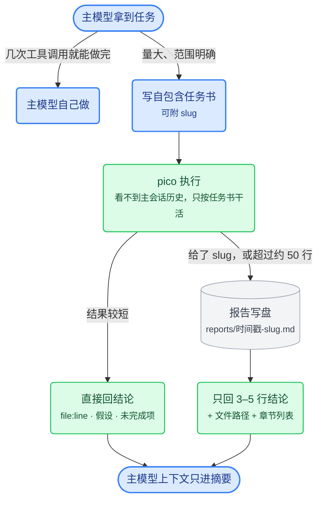

[pi-playbook](../README.md) › [主线](../README.md#文档导航) › **06 pico 子代理**

# 子代理：pico.md

子代理机制来自 [`@tintinweb/pi-subagents`](https://github.com/tintinweb/pi-subagents)，用法与 Claude Code 的子代理一脉相承：通过 `Agent` 工具派发任务，支持前台、后台或并行运行，中途可用 `steer_subagent` 纠偏，结束后用 `get_subagent_result` 取回完整输出。插件参数见 [04-高阶阶段.md](04-高阶阶段.md)，本页只拆解自建的 `pico`。

一次委托的完整链路如下：主模型先判断是否值得委托，再写出自包含任务书交给 `pico`；结果简短就直接回传，篇幅较长则落盘成报告、只回摘要。



每个自定义代理都是一份 Markdown 文件，YAML frontmatter 声明运行属性，正文即为 system prompt：

- 全局：`~/.pi/agent/agents/<name>.md`（本仓库副本见 [`config/agents/pico.md`](../config/agents/pico.md)）
- 项目：`.pi/agents/<name>.md`（项目级覆盖全局同名代理）

## pico.md 的 frontmatter

```yaml
---
description: Runs substantial, well-scoped tasks on a cheaper model and returns a concise summary, keeping raw output out of the parent's context. Good fits — repo-wide recon, independent implementation slices of a larger change, test authoring, long test/build runs, multi-source web research. Each call costs a minute or more (cold start, thinking, re-reading files), so the parent handles anything it can finish in a few tool calls itself — lookups, short Q&A, small edits and fixes. Give it a self-contained prompt; it sees nothing else.
display_name: Pico
model: deepseek/deepseek-flash
thinking: max
prompt_mode: replace
inherit_context: false
extensions: [pi-fff, pi-web-access]
skills: true
tools: find, grep, ls, bash, read, edit, write
---
```

| 字段 | 取值 | 含义 |
|------|------|------|
| `description` | 一段英文 | 主模型据此判断是否委托，详见表下说明 |
| `display_name` | `Pico` | 界面挂件与列表中显示的名称 |
| `model` | `deepseek/deepseek-flash` | DeepSeek 执行档模型，接入与思考档位见 [ref-models.md](ref-models.md)；换模型时须同步核对 `models.json` 与 `settings.json` 的 `enabledModels` |
| `thinking` | `max` | 思考档位直接影响子代理耗时；此前设为 `high`，现已调至 `max` |
| `prompt_mode` | `replace` | 以正文整体替换默认 system prompt（`append` 则在父级提示后追加） |
| `inherit_context` | `false` | 不复制主会话历史，保持上下文隔离并压低输入开销 |
| `extensions` | 两个扩展 | 声明加载 `pi-fff`（搜索）与 `pi-web-access`（联网）；实际可用工具以子代理会话内的加载和激活结果为准 |
| `skills` | `true` | 继承父代理技能 |
| `tools` | 内置工具列表 | 全部七个基础工具（find / grep / ls / bash / read / edit / write）；扩展工具另由 `extensions` 与 `ext:` 选择器控制，嵌套委托由 `allowed_subagents` 控制 |

`description` 会原样出现在 `Agent` 工具的 `subagent_type` 说明里，是主模型决定要不要委托的第一依据。它点明了两件事：适合外包给 `pico` 的重活（仓库级调研、独立实现切片、写测试、长耗时测试与构建、多源联网调研），以及每次调用至少一分钟的固定冷启动成本，提醒主模型几步工具调用就能搞定的活自己做完。措辞与全局 AGENTS.md 的委托策略保持一致。

核心设计落在两点上：

1. **内置工具与扩展工具分开控制。** `tools` 列齐了子代理插件识别的全部七个内置工具，因此 `Agent` 工具描述里 `pico` 的工具栏显示为 `*`；`extensions` 则负责加载 `pi-fff` 和 `pi-web-access`，需要更细粒度筛选时可配合 `ext:<扩展>/<工具>`。主会话靠 `override` 用上 FFF 版 `find` / `grep`，子代理会话内有时会同时暴露 `fffind` / `ffgrep`；联网工具是否顺利激活，也须在实际子代理会话中核对。

   权限边界方面：`pico` 未配置 `allowed_subagents`，嵌套委托随之关闭。但 `bash` 依然具备删文件、推代码的能力，正文只能要求这类破坏性操作必须有任务书的明确授权——最终安全性取决于模型对指令的服从度。
2. **明确模型分工。** 主模型专职推理与决策，DeepSeek Flash 专职执行。只要任务书写得够清楚，执行档按图索骥即可，主力模型的 token 便能留给真正吃判断力的环节。

## 正文 prompt 的设计

正文（system prompt）拆成五段，每段盯紧一个实际问题：

1. **自包含边界**：开篇申明任务所需的全部信息都在 prompt 里。子代理看不到主会话历史，既倒逼委托方写清任务书，也明确了子代理缺信息时的分寸——小细节自己查，缺关键决策或超出范围则直接说明并停手。
2. **云盘排除区**：`prompt_mode: replace` 下的子代理读不到全局 AGENTS.md，因此把四个云盘排除路径在正文里重申一遍；任务若撞上这些路径，不触碰文件，直接上报冲突交由主会话处理。
3. **执行纪律**：拿到任务立刻开工。正文约定了 `find` / `grep` 与 `bash` 的取舍（实际工具名以会话暴露为准），`bash` 侧优先 `fd` / `rg`；读文件只读相关区域，改代码尽量克制；严格守住任务范围，顺带发现的改进点写进报告，不越权改动。
4. **返回契约**：最终消息先给直接结论，附关键 `file:line`，再交代假设、跳过的边界与遗留项。后台完成通知只带片段预览，主模型再用 `get_subagent_result` 拉取完整结果。
5. **大报告写盘**：委托方只需在任务书中给一个 slug，子代理自行取时间戳拼出路径落盘；未给 slug 但输出超过约 50 行时，由子代理自行拟定短 slug。全文写入 `~/.pi/agent/reports/<时间戳>-<slug>.md`，最终回复只留 3–5 行核心结论、报告路径与一行章节目录。这是整套设计最省成本的一环：**大段原始材料留在磁盘，主会话上下文只进高密度摘要**。

## 与主会话的配合

`pico.md` 规定被委托方如何履约；何时委托、何时自己动手，则写在全局 `AGENTS.md` 的“子代理委托策略”里（见 [07-全局指令.md](07-全局指令.md)）。两份文件互为表里，调整规则时须同步修改。

---

← [05 界面与观测](05-界面与观测.md) · [返回目录](../README.md#文档导航) · [07 全局指令](07-全局指令.md) →
